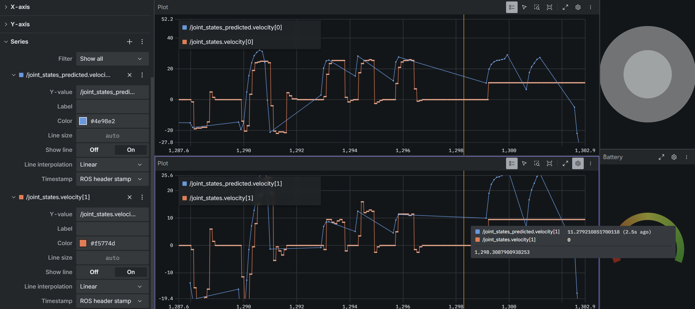
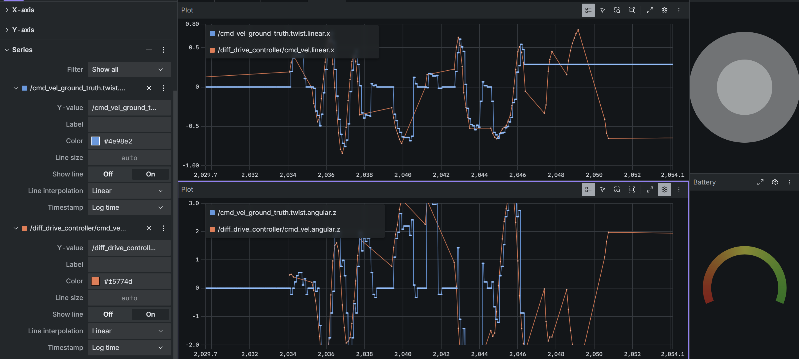

<!---
If you're new to markdown, check out this reference: https://www.markdownguide.org/basic-syntax/
-->

# Writeup

## Q0. Investigating Transforms in Foxglove (10 pts)

**Q0.1:**

It moves forward along the positive red x-axis. Both wheels spin in the positive counter-clockwise directions.

## Q1. Identifying a Kinematic Model (20 pts)

**Q1.1:** 

Each wheel sits a distance $\frac{b}{2}$ from the robot's center. Rotating at $\omega$ adds a tangential speed of $\omega \frac{b}{2}$ to each wheel on top of the forward speed $\upsilon$. With $\omega > 0$ for a counterclockwise (left) turn, the right wheel speeds up and the left wheel slows down:

$$\upsilon_l = \upsilon - \frac{\omega b}{2}$$

$$\upsilon_r = \upsilon + \frac{\omega b}{2}$$

<!---
You can use LaTeX syntax like so: $a_{example} = b_{example} + c_{example}$.
You can use $\upsilon$ for linear velocity and $\omega$ for angular velocity.

If you prefer to write out your work, you can include it in an image as follows:

-->

**Q1.2:**

A wheel rolling without slipping covers its radius $r = \frac{d}{2}$ for every radian it turns, so $\upsilon = \dot{\phi} \, r$. Solving for the spin rate:

$$\dot{\phi_l} = \frac{\upsilon_l}{d/2} = \frac{2\upsilon_l}{d}$$

$$\dot{\phi_r} = \frac{\upsilon_r}{d/2} = \frac{2\upsilon_r}{d}$$

Both wheel axes point along $+y$ of `base_link` (Q0.1), so a positive linear wheel velocity gives a positive spin rate for both wheels.

**Q1.3:** 

Inverting the Q1.1 equations, adding them cancels the $\omega$ terms and subtracting them cancels the $\upsilon$ terms:

$$\upsilon_l + \upsilon_r = 2\upsilon \quad\Rightarrow\quad \upsilon = \frac{\upsilon_r + \upsilon_l}{2}$$

$$\upsilon_r - \upsilon_l = \omega b \quad\Rightarrow\quad \omega = \frac{\upsilon_r - \upsilon_l}{b}$$

The linear velocity is the average of the two wheel speeds. The angular velocity is positive (counterclockwise, left turn) when the right wheel is faster than the left.

## Q2. Inverse Kinematics (20 pts)

**Q2.2:** 

**Q2.3:** 

Overall, the predicted wheel velocities (blue) follow the same trends as the measured encoder velocities (orange). When I push the joystick forward, both wheels rise to a positive plateau together. When I reverse, both go negative together, around -20 rad/s near t = 1288–1291. During turns, the left and right wheels separate in the way the model predicts: the left wheel sits around 25 rad/s while the right wheel sits around 10 rad/s (t ≈ 1293–1297). So the signs, the timing, and the rough sizes all agree, and my IK equations look correct.

The values aren't identical, though. The main differences are:

- **Lag:** The measured velocity trails the prediction by a fraction of a second at every step. The prediction changes the instant the command arrives, but the motors need time to accelerate the wheels and the rover.
- **Measured steps vs. a smooth prediction:** The measured signal moves in small steps. The encoders have finite resolution, `/joint_states` updates at 50 Hz, and the controller averages the velocity over a short rolling window.
- **Small negative blips when stopping:** The measured velocity briefly goes slightly negative each time the rover stops. This is the controller overshooting and braking, which my simple model doesn't include.
- **Model assumptions:** My model assumes ideal, rigid wheels that never slip, with exactly the nominal diameter (0.066 m) and wheel separation (0.15 m). In reality, wheel slip on the floor, tire squish, and small differences between the left and right motors make the actual speeds differ from the ideal ones.

Near the end of the plot (after t = 1299), the measured traces go flat at a constant value while the prediction keeps changing. Most likely the `/joint_states` data stopped updating there, possibly because of the dropped robot connection I saw around then, so I'm not using that section for the comparison.

## Q3. Forward Kinematics (20 pts)

**Q3.2:** 

The **linear velocity** matches the command closely. The actual (blue) curve follows the commanded (orange) curve through every forward and reverse movement: for example, the dips to about -0.6 m/s near t ≈ 2036–2037, 2040, and 2044–2045, and the peaks around 0.5–0.6 m/s at t ≈ 2043 and 2046. The main differences are:
- The actual velocity lags the command slightly.
- The actual velocity moves in small steps instead of a smooth curve.
- The actual velocity doesn't always reach the full commanded peak. Near t ≈ 2037, the command reaches about -0.8 m/s, but the actual only gets to about -0.5 m/s.

**What could account for those differences?**

- **Motor and rover dynamics:** The rover has mass and the motors have limited torque, so the wheels can't change speed instantly. This causes the lag and the smaller peaks, especially on sudden large commands.
- **Wheel slip:** Driving forward needs very little sideways grip, but turning a differential-drive rover makes the wheels scrub sideways against the floor. Since my forward kinematics only uses wheel encoder speeds, slip makes the calculated velocity differ from the robot's real motion. Turning is affected more, which helps explain why angular velocity matches worse than linear velocity.
- **Angular velocity amplifies wheel-speed error:** $\omega = \frac{\upsilon_r - \upsilon_l}{b}$ divides the difference between two wheel speeds by a small separation (b = 0.15 m). A small error in either wheel's measured speed becomes a large error in $\omega$. For example, 0.05 m/s of error becomes about 0.33 rad/s. In contrast, $\upsilon$ is an average of the two wheels, which smooths out noise. This is why the angular plot is much noisier than the linear plot.
- **Encoder resolution and sampling:** Wheel velocities come from encoder counts sampled at 50 Hz, which produces the step-like shape and some noise.

## Q4. Calculating an Odometry Solution (30 pts)

**Q4.3:** 

## Feedback

**How much time did you spend on this assignment?** 

**Do you have any feedback for this assignment?**
